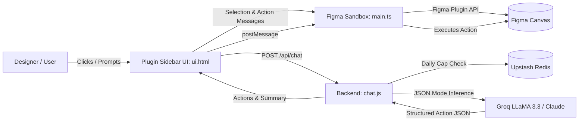

# Figma Copilot ⚡🎨

[](https://www.figma.com/)
[](https://nodejs.org/)
[](https://www.typescriptlang.org/)
[](https://esbuild.github.io/)
[](https://groq.com/)
[](https://upstash.com/)
[-D04423?logo=microsoftpowerpoint&logoColor=white)](https://gitbrent.github.io/PptxGenJS/)

> **A persistent AI sidebar copilot for Figma.** Select any layer or multiple screens, speak plain English, and watch design changes execute directly on the Figma canvas in real time.

---

## 🌟 Highlights

- **🧠 Deep Canvas Intelligence**: Real-time awareness of selected layers, hierarchy, text contents, design tokens, color styles, and variables.
- **⚡ Direct Canvas Execution**: Renames layers, edits text, updates colors, fixes corner radiuses, adjusts padding, resizes, duplicates, and reorders elements instantly.
- **📐 1-Click Auto-Layout Engine**: Automatically detects non-autolayout frames, calculates optimal padding and item gaps, and applies responsive auto-layout.
- **🌙 Instant Dark Mode**: Analyzes light-themed templates and seamlessly translates them into polished, high-contrast dark mode interfaces.
- **🎨 Smart Color Palette Generator**: Curates cohesive color schemes tailored for Enterprise Dashboards, Light UI, or Dark UI with interactive visual previews.
- **📥 Figma-to-PowerPoint Export**: Converts Figma frames directly into editable `.pptx` slides powered by client-side PptxGenJS.
- **🛡️ Built-in Usage Caps**: Serverless rate limiting backed by Upstash Redis (configurable per-user daily message limit).
- **🚀 Flexible Backend**: Supports ultra-fast Groq LLaMA 3.3 70B inference with fallback, compatible with Vercel serverless and local Node.js hosting.

---

## 🏗️ Architecture

```
figma-copilot/
├── plugin/                     ← Figma Desktop Plugin
│   ├── src/
│   │   ├── main.ts             ← Figma Sandbox (Talks to Figma Plugin API & executes canvas mutations)
│   │   └── ui.html             ← Persistent Sidebar UI (Chat, Autolayout, PPTX, Dark Mode)
│   ├── build-ui.js             ← Inlines vendor dependencies (JSZip & PptxGenJS) into dist/ui.html
│   ├── manifest.json           ← Figma plugin manifest definition
│   ├── package.json
│   └── tsconfig.json
│
└── backend/                    ← Serverless & Local AI Backend
    ├── api/
    │   └── chat.js             ← Unified API handler (Groq LLaMA 3.3 / Claude + Upstash Redis)
    ├── server.js               ← Standalone local development HTTP server (Zero-config)
    ├── .env.example            ← Environment configuration template
    └── package.json
```



---

## ⚡ Quick Start & Running Locally

### Prerequisites
- **Node.js**: v18.0.0 or higher
- **npm**: v9.0.0 or higher
- **Figma Desktop App**: (Mac, Windows, or Linux)

---

### Step 1: Install Dependencies

#### 1. Install Plugin Dependencies:
```bash
cd plugin
npm install
```

#### 2. Install Backend Dependencies:
```bash
cd ../backend
npm install
```

---

### Step 2: Build the Plugin

Run the build script to compile TypeScript with `esbuild` and inline required client libraries into `dist/`:
```bash
cd plugin
npm run build
```
> This produces `dist/main.js` and `dist/ui.html`.

For continuous development and auto-rebuilding on save:
```bash
npm run watch
```

---

### Step 3: Run the Backend

You can run the backend either **locally** or deploy it to **Vercel**.

#### Option A: Run Locally (Recommended for Development)
1. In the `backend/` directory, copy `.env.example` to `.env`:
   ```bash
   cd backend
   cp .env.example .env
   ```
2. Add your **Groq API Key** (from [console.groq.com](https://console.groq.com)) or **Anthropic Key**:
   ```env
   GROQ_API_KEY=gsk_your_groq_api_key_here
   PORT=3001
   ```
3. Start the local server:
   ```bash
   npm run dev
   # or: node server.js
   ```
   The backend will be running at: `http://localhost:3001/api/chat`

4. *(Optional)* Point the plugin to your local server in `plugin/src/ui.html`:
   ```javascript
   const BACKEND_URL = 'http://localhost:3001/api/chat';
   ```
   *(Re-run `npm run build` after changing the URL).*

#### Option B: Deploy to Vercel
```bash
cd backend
npx vercel
# Follow CLI prompts and add environment variables:
npx vercel env add GROQ_API_KEY
npx vercel env add UPSTASH_REDIS_REST_URL
npx vercel env add UPSTASH_REDIS_REST_TOKEN
npx vercel --prod
```

---

### Step 4: Load into Figma Desktop

1. Open the **Figma Desktop App**.
2. Open any design file.
3. Click the **Figma Menu** (`☰`) → **Plugins** → **Development** → **Import plugin from manifest...**.
4. Browse to and select:
   ```
   figma-copilot/plugin/manifest.json
   ```
5. Launch the plugin from **Plugins** → **Development** → **Figma Copilot**.

---

## 🎯 Supported Natural Language Commands

| You Say | What Happens on Canvas |
|---|---|
| *"Rename this layer to Hero Section"* | Updates layer name in the layers panel |
| *"Change the title to Launch Week"* | Matches text node characters and edits visible canvas text |
| *"Replace '2023' with '2024' across all screens"* | Batch replaces text across all selected frames |
| *"Make this button royal blue"* | Sets fill color (`r, g, b, a`), variable binding, or style |
| *"Audit this frame for design flaws"* | Reports spacing, alignment, typography, and contrast issues |
| *"Fix corner radius to 12px"* | Standardizes corner radii to match design system |
| *"Add 24px padding"* | Applies autolayout padding uniformly |
| *"Make this frame responsive"* | Infers layout orientation and applies Auto-Layout |
| *"Suggest a modern color palette"* | Generates 5–7 coordinated colors with preview swatches |
| *"Export this presentation to PPTX"* | Generates an editable Microsoft PowerPoint file |

---

## 🛠️ Supported Figma Action Schema

The backend outputs strict JSON schema parsed and executed by the plugin sandbox:

```typescript
type FCAction =
  | { type: "RENAME_LAYER"; nodeId: string; name: string }
  | { type: "SET_TEXT"; nodeId: string; value: string }
  | { type: "REPLACE_TEXT_IN_SELECTION"; from: string; to: string }
  | { type: "SET_FILL_COLOR"; nodeId: string; r: number; g: number; b: number; a?: number; variableId?: string; styleId?: string }
  | { type: "SET_CORNER_RADIUS"; nodeId: string; value: number }
  | { type: "SET_OPACITY"; nodeId: string; value: number }
  | { type: "SET_PADDING"; nodeId: string; value: number }
  | { type: "SET_SIZE"; nodeId: string; width: number; height: number }
  | { type: "SET_POSITION"; nodeId: string; x?: number; y?: number }
  | { type: "MOVE_BY"; nodeId: string; dx?: number; dy?: number }
  | { type: "DUPLICATE_NODE"; nodeId: string; offsetX?: number; offsetY?: number }
  | { type: "DELETE_NODE"; nodeId: string }
  | { type: "CREATE_FRAME"; name?: string; width: number; height: number; x: number; y: number }
  | { type: "NAVIGATE_TO"; nodeId: string }
  | { type: "SET_AUTO_LAYOUT"; nodeId: string; layoutMode: "VERTICAL" | "HORIZONTAL"; itemSpacing?: number; paddingTop?: number; paddingBottom?: number; paddingLeft?: number; paddingRight?: number }
  | { type: "SUGGEST_COLORS"; suggestions: Array<{ nodeId: string; nodeName: string; oldColor: RGB; newColor: RGB }> }
```

---

## 📦 Dependency Breakdown & Storage Footprint

| Component | Main Libraries | Purpose | Disk Space |
|---|---|---|---|
| **Plugin** | `typescript` (5.9.3)<br>`esbuild` (0.20.2)<br>`pptxgenjs` (4.0.1)<br>`@figma/plugin-typings` | TypeScript compilation, bundling, PowerPoint generation, and Figma API typings | **~51 MB** |
| **Backend** | `@anthropic-ai/sdk` (0.39.0)<br>`@upstash/redis` (1.37.0)<br>`native fetch` | Rate limiting, usage counters, and LLM orchestration | **~9.4 MB** |
| **Build Artifacts** | `dist/main.js` (39 KB)<br>`dist/ui.html` (434 KB) | Bundled standalone plugin distribution files | **~476 KB** |
| **Combined Dependencies** | `node_modules` total | All installed project packages | **~60.4 MB** |

---

## 🔒 Security & Privacy

- **Client-Side Safe**: Sensitive API keys remain in your secure backend server / environment variables and are never bundled into the Figma plugin client.
- **Privacy First**: Only selected layer metadata is sent to the LLM when executing commands. Full canvas data is never scraped or transmitted.
- **Rate-Limited**: Configurable daily per-user message limits protect your API quota from abuse.

---

## 📄 License

MIT License. Feel free to use, modify, and distribute for personal and commercial projects.
